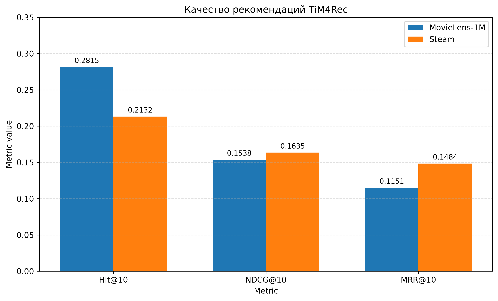

# Оценка модели TiM4Rec на наборах MovieLens-1M и Steam

## 1. Цель работы

Целью эксперимента являлась оценка качества последовательной рекомендательной модели
**TiM4Rec** на *MovieLens-1M* и *Steam*.

TiM4Rec относится к последовательным рекомендательным моделям и использует
временную информацию о взаимодействиях пользователя с объектами.
В рамках эксперимента модель обучалась независимо для каждого набора данных.

## 2. Используемые данные

В эксперименте использовались два открытых набора данных:

- **MovieLens-1M** — взаимодействия пользователей с фильмами.
- **Steam** — пользовательские взаимодействия с играми платформы Steam.

Перед обучением данные были приведены к формату `user_id, item_id, timestamp`.

Дополнительно в данных оставлялись только пользователи и объекты,
имеющие не менее пяти взаимодействий (**5-core фильтрация**).

Для MovieLens-1M после фильтрации осталось *6040* пользователей, *3416* объектов и *999 611* взаимодействий.

Максимальная длина пользовательской последовательности была установлена равной *200* для *MovieLens* и *50* для *Steam*.

## 3. Протокол эксперимента

Взаимодействия каждого пользователя упорядочивались по времени.
Для *validation* и *test* использовались последние взаимодействия пользователя (**chronological leave-one-out split**).

Основные параметры TiM4Rec:

- размер скрытого представления — 64;
- количество слоёв — 2;
- `d_state = 32`;
- `d_conv = 4`;
- `head_dim = 32`;
- `chunk_size = 32`;
- optimizer — Adam;
- learning rate — 0.001;
- batch size — 2048;
- максимальное число эпох — 40.

Лучший *checkpoint* выбирался по значению **NDCG@10** на validation-выборке.

## 4. Метрики

Для оценки использовались три группы ranking-метрик с *K = 10*, *20* и *50*.

**Hit@K** показывает долю пользователей, для которых правильный следующий объект оказался среди первых K рекомендаций.

Например, `Hit@10 = 0.2815` означает, что правильный объект
присутствовал в *Top-10* рекомендаций для *28.15%* пользователей.

**NDCG@K** дополнительно учитывает позицию правильного объекта.
Чем ближе правильная рекомендация к началу списка, тем выше значение *NDCG*.

**MRR@K** также учитывает позицию правильного объекта, но ещё сильнее поощряет нахождение его на первых местах списка.
Если правильный объект находится на первой позиции, вклад пользователя равен *1*; на второй *0.5*; на пятой *0.2*.

Во всех случаях большее значение соответствует лучшему качеству модели.

## 5. Результаты

Итоговые результаты на тестовой выборке:

| Dataset | Hit@10 | Hit@20 | Hit@50 | NDCG@10 | NDCG@20 | NDCG@50 | MRR@10 | MRR@20 | MRR@50 |
|---|---:|---:|---:|---:|---:|---:|---:|---:|---:|
| MovieLens-1M | 0.2815 | 0.3929 | 0.5469 | 0.1538 | 0.1820 | 0.2126 | 0.1151 | 0.1228 | 0.1277 |
| Steam | 0.2132 | 0.2655 | 0.3623 | 0.1635 | 0.1766 | 0.1958 | 0.1484 | 0.1520 | 0.1550 |

На рисунке представлены значения основных метрик при *K = 10*.

****

На графике видно, что *MovieLens-1M* превосходит Steam по метрике *Hit@10*,
тогда как Steam показывает более высокие значения *NDCG@10* и *MRR@10*.

## 6. Анализ результатов

На *MovieLens* модель показала более высокое значение *Hit Rate*. Правильный следующий фильм находился в *Top-10* рекомендаций
примерно для **28.2% пользователей**, а в *Top-50* уже для **54.7% пользователей**.

Для *Steam* вероятность попадания правильного объекта в *Top-K* оказалась ниже: `Hit@10 = 21.3%` и `Hit@50 = 36.2%`.

Как видно из рисунка, при переходе к метрикам, учитывающим позицию правильной рекомендации, ситуация меняется.
`NDCG@10` для Steam составляет **0.1635**, тогда как для MovieLens — **0.1538**.
Аналогично `MRR@10` составляет **0.1484** для Steam против **0.1151** для MovieLens.

Это означает, что на *MovieLens TiM4Rec* чаще включает правильный объект в список рекомендаций вообще,
однако на *Steam* в тех случаях, когда правильная рекомендация найдена, она чаще располагается ближе к началу списка.

Особенно хорошо эта разница заметна для MRR@10 значение *Steam* примерно на *29%* выше значения *MovieLens*.
Следовательно, для *Steam* модель чаще располагает успешно предсказанную игру на одной из первых позиций рекомендательного списка.

Значения *validation* и *test* для *MovieLens* также достаточно близки, лучший *validation* `NDCG@10` равен *0.1625*,
а *test — 0.1538*. Это свидетельствует об отсутствии выраженного переобучения.

Для Steam лучший validation `NDCG@10` составил *0.1879* при test `NDCG@10 = 0.1635`.
Разница здесь несколько больше, однако модель сохраняет достаточно высокие значения *NDCG* и *MRR* на тестовой выборке.

## 7. Вывод

Эксперимент показал, что характер качества рекомендаций зависит от набора данных.
На *MovieLens* модель обеспечивает более высокий охват правильных объектов в *Top-K*, тогда как на *Steam*
успешные рекомендации в среднем располагаются выше в ранжированном списке.

Использование временного *leave-one-out* разбиения позволяет оценивать способность модели предсказывать будущие
взаимодействия пользователя на основании его предыдущей истории.
